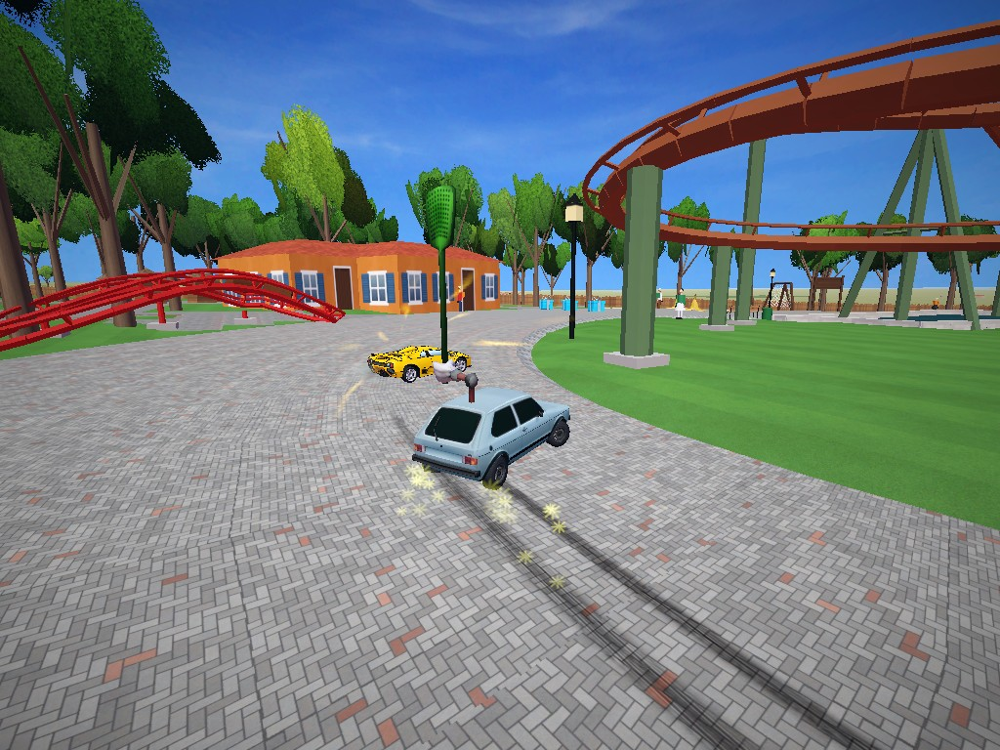

# Familypark - Götterblitz

A [SuperTuxKart](https://supertuxkart.net) add-on track in the Familypark, the amusement park in St. Margarethen im Burgenland by the Neusiedler See. The lap starts inside the main gate, runs through the Drachenhöhle into the Abenteuerinsel, round the Götterblitz roller coaster and back past Rotonda, then east through the Bauernhof past the Waldexpress and the Biberburg to the Rattenmühle coaster, and back along the Apfelflug, the Almjodler and the rides of the Erlebnisburg to the gate. The coaster trains, the trains and the carousels move.



## Install

Clone it into your SuperTuxKart add-on tracks folder:

```bash
cd ~/.local/share/supertuxkart/addons/tracks
git clone https://github.com/AronNovak/stk-track-familypark.git
```

The tracks folder is `%APPDATA%\supertuxkart\addons\tracks` on Windows and `~/Library/Application Support/SuperTuxKart/addons/tracks` on macOS. Without git, download the ZIP and extract it there.

The track shows up under the Add-Ons group. Tested with SuperTuxKart 1.5.

## License

Copyright © 2026 Áron Novák. Licensed under [CC BY-SA 4.0](license.txt).

Paths, building footprints and the rides' tracks are derived from map data © [OpenStreetMap](https://www.openstreetmap.org/copyright) contributors, available under the ODbL. Terrain heights are produced using Copernicus data and information funded by the European Union (EU-DEM).

The music and sky box come from the SuperTuxKart base game and are not part of this repository. The park, its rides and their names are shown as they are and the track is not endorsed by Familypark GmbH.
